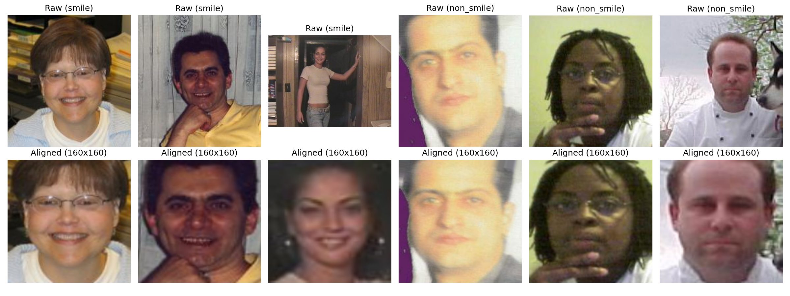
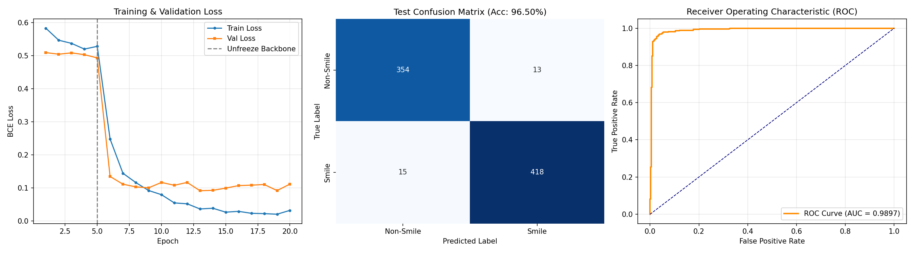

# Real-Time Smile Detection with Face Alignment and InceptionResNetV1


A real-time binary smile classification project trained on the **GENKI-4K** dataset. It uses **MediaPipe FaceLandmarker** for eye-based geometric face alignment and an **InceptionResNetV1** backbone (pretrained on VGGFace2) fine-tuned in PyTorch.

---

## Methodology

### 1. Geometric Face Alignment
To normalize head tilt and framing variations before classification, each face is preprocessed using **MediaPipe FaceLandmarker** (478 landmarks):
- Extracts left and right eye coordinates to compute the roll angle.
- Applies an affine rotation to horizontally align the eyes and crops the face to `160x160`.



### 2. Data Split & Training Setup
- **Dataset**: GENKI-4K (4,000 images: 2,162 Smile, 1,838 Non-Smile), split stratified into **70% Train (2,800)**, **10% Validation (400)**, and **20% Test (800)**.
- **Loss & Augmentation**: Uses class-weighted `BCEWithLogitsLoss` (`pos_weight`) to handle class imbalance, alongside random horizontal flips, color jitter, and minor affine shifts on the training set.
- **Two-Stage Fine-Tuning**:
  1. **Stage 1 (5 epochs)**: Freezes the VGGFace2-pretrained `InceptionResNetV1` backbone and trains a custom classification head (`Linear(512, 128) -> BatchNorm -> ReLU -> Dropout -> Linear(128, 1)`).
  2. **Stage 2**: Unfreezes the full network and fine-tunes end-to-end using AdamW (`lr = 2e-5`).

---

## Test Set Results (800 Images)

| Metric | Non-Smile (0) | Smile (1) | Overall / Macro |
| :--- | :---: | :---: | :---: |
| **Precision** | 0.9593 | 0.9698 | 0.9646 |
| **Recall** | 0.9646 | 0.9654 | 0.9650 |
| **F1-Score** | 0.9620 | 0.9676 | 0.9648 |
| **Accuracy** | — | — | **96.50%** |
| **ROC-AUC** | — | — | **0.9897** |



---

## Repository Structure

```text
realtime-smile-detection/
├── models/
│   ├── best_smile_model.pth             # Fine-tuned model checkpoint
│   └── face_landmarker.task             # MediaPipe FaceLandmarker asset
├── notebooks/
│   ├── 01-genki4k-smile-training.ipynb  # Training and evaluation notebook
│   ├── alignment_comparison.png         # Raw vs. aligned face preprocessing output
│   └── evaluation_results.png           # Loss/accuracy curves, confusion matrix, ROC
├── src/
│   ├── smile_detector.py                # Model architecture and FaceAligner class
│   └── inference_video.py               # Webcam and video inference script
└── README.md